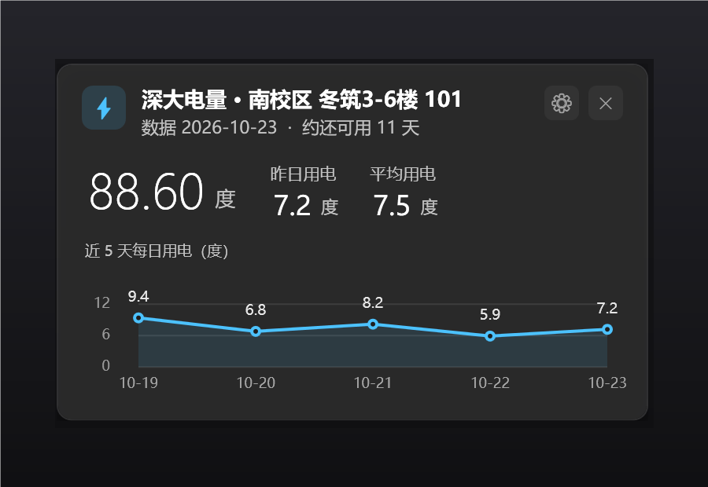

# 深大宿舍电量查询

深圳大学宿舍电表查询，做成桌面小卡片：剩余电量、昨日用电、近 5 天折线图、预估还可用几天，电量低了会提醒。

数据来自校内电控系统（`192.168.84.3:9090/cgcSims`），**必须连校园网**。

| 平台 | 形态 | 目录 | 说明 |
|---|---|---|---|
| Windows 10/11 | 右下角浮出卡片 + 托盘 + 全局热键 | [`windows/`](windows/) | PowerShell + WPF，免安装、不打包 exe |
| macOS 11+ | 菜单栏图标 + 弹出面板 + 全局热键 | [`mac/`](mac/) | Swift / AppKit + SwiftUI，Intel 与 Apple Silicon 通用 |



## 安装

### Windows

1. 下载本仓库（`Code → Download ZIP`），解压到任意目录
2. 双击 `windows/安装.bat`
3. 跟着向导填：主题 / 校区 / 楼栋 / 房间号 / 快捷键

之后按热键（默认 `Ctrl+Alt+E`）出卡片，托盘图标右键有菜单。细节见 [`windows/README.md`](windows/README.md)。

### macOS

1. 下载 Actions 里构建好的 `深大电量-mac.zip`（[Actions 页面](https://github.com/hongsawd/szu-battery-inquiry/actions) → 最新一次运行 → Artifacts），或自己编：

   ```bash
   cd mac
   ./build.sh
   ```

2. 首次打开要右键 →「打开」（没做签名公证）
3. 菜单栏出现 ⚡，点一下出卡片；配置在首次启动时填

细节见 [`mac/README.md`](mac/README.md)。

## 原理

不是爬数据库，也不是破解，就是**替你在后台提交两次网页表单**：

1. `POST /login.do` —— 带上楼栋名（GBK 百分号编码）和房间号，服务端回一个 `roomId`
2. `POST /selectList.do` —— 用 `roomId` 拉用电流水表（HTML 表格）
3. 正则从表格里取每行的「剩余电量 / 已用电量 / 日期」，相邻两天相减得到每日用量

服务端一次最多回 20 条记录，所以两个平台都分两段抓（近 20 天 + 再往前 15 天）再合并。

平均用电的口径：近一个月逐日差值，剔掉 ≤0 度（电表归零）和 >80 度/天（跳变）的异常值后取平均；「约还可用 N 天」= 剩余 ÷ 平均（向下取整）。

电控系统一天才结算一次，所以看到的永远是昨天的数据。

## 目录

```
windows/    Windows 版全部文件（双击 安装.bat 即可）
mac/        macOS 版全部文件（./build.sh 出 .app）
docs/       预览图
.github/    macOS 构建流水线（用 GitHub 的 macOS 机器编译 + 自检）
```

## 免责

只查自己宿舍的电量，不涉及任何账号密码（那套系统靠「在校园网内」放行）。接口是校方公开网页用的接口，脚本只是把人工点两下的操作自动化了。用的人多可能给电控系统带来压力，请自觉把刷新频率放低。
