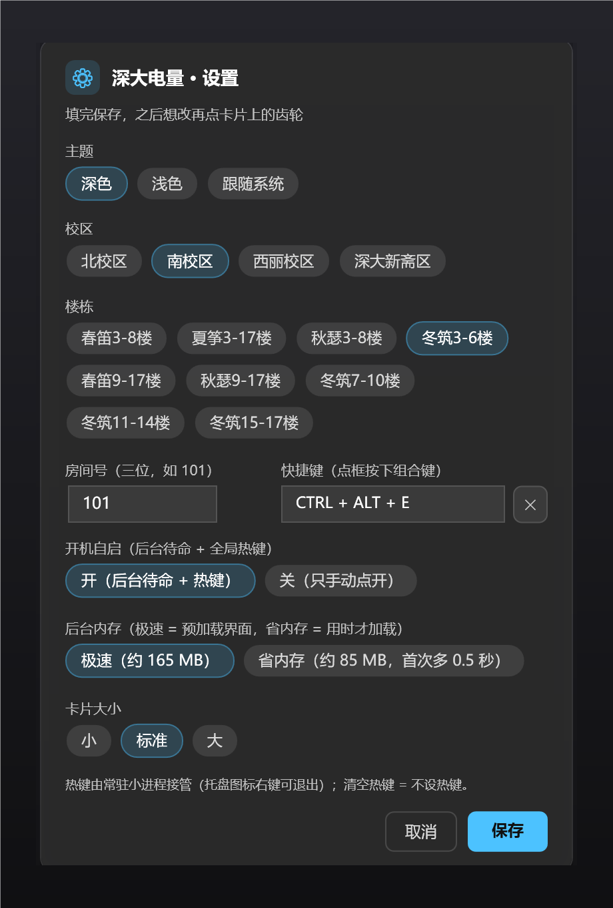

# 深大宿舍电量查询（Windows 桌面小工具）

深圳大学宿舍电表查询，做成一张 Win11 通知样式的小卡片：剩余电量、昨日用电、近 5 天折线图、预估还可用几天。




- 首次运行弹设置向导：主题（深色 / 浅色 / 跟随系统）、校区、楼栋、房间号、全局快捷键
- 卡片右上角齿轮，随时改设置
- 回车 / 点击卡片关闭，20 秒自动淡出
- 每次查询追加一行本地历史：`%LOCALAPPDATA%\szu-power\history.csv`

## 环境要求

- Windows 10 / 11（自带 Windows PowerShell 5.1 即可，无需安装额外运行库）
- **校内网**（宿舍电控系统是 `192.168.84.3` 内网地址，校外 / 手机热点查不到）

## 安装

1. 下载本仓库（Code → Download ZIP），解压到任意位置，路径里带中文也没关系
2. 双击 `安装.bat`
3. 按向导选：主题 → 校区 → 楼栋（列表从服务器实时拉取）→ 房间号 → 快捷键，点「保存」
4. 桌面会多出「深大电量」快捷方式，双击即查；设了快捷键的话直接按键也行

## 快捷键

- 支持的组合：`Ctrl` / `Alt` / `Shift` / `Win` 任意组合 + 一个键（键 = A-Z / 0-9 / F1-F12），例如 `Ctrl+Alt+E`、`Win+Alt+E`
- 录入时就会试注册一次：被系统或别的程序占用，会在下面标红提示「保存也能保存，但按下去可能不生效」——不拦着保存
- 设置：点向导里的快捷键框，直接按下组合键（Win 组合需要先按 Win 再按其他键）；按 Backspace 或点旁边的 ✕ 可以清空
- **清空 = 不设热键**：常驻进程和开机自启都会一并撤掉，只能用桌面图标打开

热键由一个常驻小进程接管（托盘里有个闪电图标，右键可「查看电量 / 设置 / 退出常驻」）。
它开机时自动启动，保持数据缓存新鲜，所以**按热键到卡片弹出大约 0.15 秒**；没常驻进程时要冷启动 PowerShell，约 1 秒。

## 关于开机自启（可以关）

设置向导里有一行「开机自启（后台待命 + 全局热键）」：

| 选择 | 行为 |
|---|---|
| **开（默认）** | 登录时启动一个隐藏的常驻进程（托盘有图标），热键随时可用，卡片 0.15 秒弹出 |
| **关** | 不写启动项、不常驻、没有托盘图标、热键无效；只能点桌面图标，每次冷启动约 1 秒 |

原理：Windows 在用户登录时会把
`%APPDATA%\Microsoft\Windows\Start Menu\Programs\Startup\` 里的快捷方式挨个执行一遍。
我们只是在那里放了一个指向 `agent.vbs` 的 `.lnk`，`agent.vbs` 再隐藏窗口启动
`powershell szu-power.ps1 -Agent`。没有注册表 Run、没有服务、没有计划任务。

关掉之后，这个 `.lnk` 会被删除；如果当时常驻进程还活着，它会在 2 秒内读到配置变化自行退出。

## 卡片大小

设置里有「卡片大小」三档：小（0.85×）/ 标准（1×）/ 大（1.25×），存在 `config.json` 的 `scale` 里。

实现方式是给根 Border 套一层 `LayoutTransform`，窗口 `SizeToContent` 自动跟随——
所以字号、图表、圆角、留白全部等比缩放，排版比例不变，矢量也不会糊。

托盘右键菜单是**自绘的 WPF 面板**（圆角、强调色图标、hover 高亮、分隔线），配色跟随「深色 / 浅色 / 跟随系统」。

不抢前台焦点是它能"点外面就关"的关键：窗口带 `WS_EX_NOACTIVATE` 从不激活，改用低级鼠标/键盘钩子判断点击是否落在面板矩形外，
落在外面就收起并吞掉那一击（和原生菜单一致）；Esc 同理。菜单锚在你右键的那个图标上，悬停提示会被临时收掉，不会糊在面板上。

## 关闭与复制

- 卡片**不再"点哪都关"**：只有右上角 ✕、回车、Esc 会关
- 三个数字是只读输入框，可以按住拖选、Ctrl+C
- 右键卡片 →「复制全部」，得到一段纯文本：

```
深大电量 · 南校区 冬筑3-6楼 101
剩余 128.60 度
昨日用电 9.87 度
平均用电 10.12 度
数据 2026-10-01 · 约还可用 12 天
```

## 托盘提示（鼠标悬停）

悬停托盘里的闪电图标会显示一行实时摘要：

```
冬筑3-6楼 101 · 剩 128.6 度 · 约 12 天 · 09:57 更新
```

规则与限制：

- Windows 托盘提示**最多 63 个字符**（第 64 个字符会抛「文本长度必须少于 64 个字符」）
- 不能换行；换行会被压成空格
- 超过 63 字时截断并补「…」，不会报错
- 文案随缓存刷新更新：预取写完缓存后 2 秒内自动换新

## 后台占用与刷新策略

| 模式 | 常驻内存（专用工作集） | 首次出卡片 |
|---|---|---|
| 极速（默认） | 约 165 MB | 0.15 秒 |
| 省内存 | 约 85 MB | 加约 0.5 秒 |

内存的大头是 WPF（界面库）本身：裸 PowerShell 约 73 MB，加载 WPF 后约 154 MB。
「省内存」就是不在常驻里预加载 WPF —— 但**打开过一次卡片后 WPF 仍会驻留**，
内存会回到 160 MB 上下，直到进程重启。要恒定低占用，只能让卡片跑在独立进程里（每次多 1 秒）。

联不上网也不影响使用：卡片显示的是本地缓存，缓存超过 6 小时才在后台补一次。
早期版本每 10 分钟拉一次，纯浪费——电控系统一天只更新一次。

## 快捷方式出问题了？

症状：双击后弹出「Windows 脚本宿主设置」，而不是电量卡片。

原因：快捷方式只记了 `wscript.exe` 却没带脚本参数（早期版本用参数指定脚本，参数丢失就会这样）。
现在快捷方式**直接指向 `.vbs` 文件**，不依赖参数，这个毛病不会再有。

老快捷方式可以一键修：

```
powershell -ExecutionPolicy Bypass -File szu-power.ps1 -Repair
```

或者右键托盘图标 →「修复快捷方式」。

## 改设置

卡片右上角的齿轮 ⚙，或者再双击一次 `安装.bat`。

## 文件说明

| 文件 | 作用 |
|---|---|
| `szu-power.ps1` | 全部逻辑：查询、解析、设置向导、卡片绘制 |
| `szu-power.vbs` | 静默启动器（避免弹黑框），快捷方式直接指向它 |
| `agent.vbs` | 专供开机自启：带 `-Agent` 启动常驻进程 |
| `安装.bat` | 创建桌面快捷方式 + 打开设置向导 |
| `icon.ico` | 图标（线框风，16/24/32/48/64/128 用 DIB，256 用 PNG；托盘也用这一个） |
| `生成图标.ps1` | 想换图标就跑它，改两个色号即可 |

配置文件在 `%LOCALAPPDATA%\szu-power\config.json`，不在仓库里，所以换电脑 / 分享仓库都不会带出你的房间号。

## 换个图标

```
powershell -ExecutionPolicy Bypass -File 生成图标.ps1 -Preview     # 先出 preview.png 看效果
powershell -ExecutionPolicy Bypass -File 生成图标.ps1              # 覆盖 icon.ico（默认蓝底闪电）
powershell -ExecutionPolicy Bypass -File 生成图标.ps1 -Preset violet -Glyph power -Label "电"
```

参数：

| 参数 | 取值 | 说明 |
|---|---|---|
| `-Style` | line / solid | 线框风（默认）/ 渐变实心 |
| `-Bg` `-Ink` | `#RRGGBB` | 线框风的底色 / 线条色 |
| `-Preset` | blue / violet / green / amber / slate | 渐变配色（solid 用） |
| `-Glyph` | bolt / power / battery / none | 内置图形 |
| `-Label` | 任意短文字 | 图形下方加文字，如「电」 |
| `-LabelRotate` | 角度 | 文字旋转 |
| `-Radius` | 百分比 | 四角统一圆角 |
| `-RadiusTL/-TR/-BR/-BL` | 百分比 | 单个角独立设置（做异形底座） |
| `-Overlay` | PNG 路径 | 用你自己的图替代内置图形 |

重新生成后重启一次常驻进程（托盘右键退出，或注销重新登录），图标就换过来了。

## 出一张演示图

```
powershell -ExecutionPolicy Bypass -File szu-power.ps1 -Demo
```

用假数据（房间 101、88.60 度、近 5 天虚构曲线）渲染一张卡片，专门用来截图。
README 里的图都是这么出的，不含任何真实住址和读数。

## 数字怎么算的

| 指标 | 口径 |
|---|---|
| 剩余电量 | 电控系统最新的「剩余电量(度)」 |
| 昨日用电 | 最新一天的总用电量 − 前一天的总用电量 |
| 平均用电 | 近 30 天逐日用电的均值；先剔掉电表归零（差值≤0）和异常跳变（>80 度/天） |
| 约还可用 | 剩余电量 ÷ 平均用电，向下取整 |
| 折线图 | 只画最近 5 天，不参与平均值计算 |

一次查询要抓两段：电控系统的 `selectList.do` 单次最多返回 20 条记录，
所以脚本先取「最近 20 天」，再补「往前 15 天」，按日期合并去重，凑出一个月。

历史流水写在 `%LOCALAPPDATA%\szu-power\history.csv`：

```
query_time,data_date,remain,used_total,bought_total,avg_per_day,days_left
```

（旧版只有前 5 列，首次运行会自动归档成 `history-legacy.csv`。）

## 原理

数据来自学校的 SIMS 电控网上查询系统，公开表单接口，没有登录态：

1. `GET /cgcSims/login.do?task=station&client=<校区IP>` —— 拿该校区楼栋列表（校区 → 内网 IP）
2. `POST /cgcSims/login.do` —— 用楼栋 id + 房间号换出系统内部的 `roomId`
3. `POST /cgcSims/selectList.do` —— `type=2` 查用电记录，返回 HTML 表格（GBK 编码）
4. 相邻两天的「总用电量」相减 = 当天用电；剩余 ÷ 近几天均值 = 预计可用天数

界面是 WPF 自绘的，不是系统 Toast，所以能画折线图、能跟随深浅色。

## 免责

非官方工具，只读查询自己宿舍的电表数据，不改任何东西。系统接口哪天变了，卡片会变成「查询失败」并给出原因。


