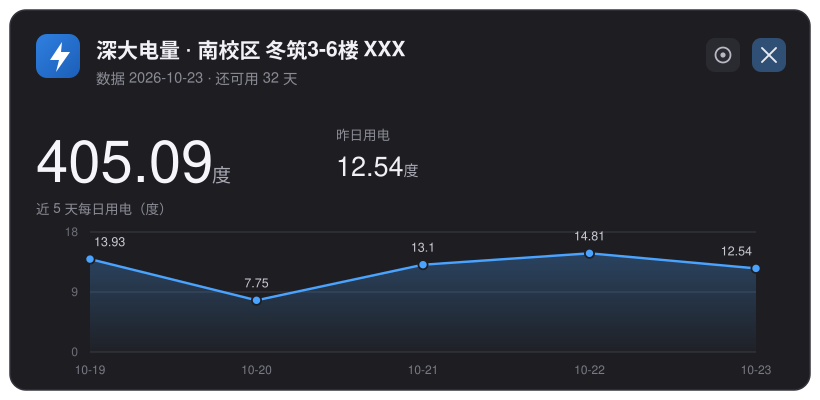

# 深大宿舍电量查询（Windows 桌面小工具）

深圳大学宿舍电表查询，做成一张 Win11 通知样式的小卡片：剩余电量、昨日用电、近 5 天折线图、预估还可用几天。



> 上图是按真实布局重绘的 **SVG 示意图**，不是截图；房间号一律写成 `XXX`。
> 想要真实效果就装一次，按下快捷键自己看。

设置向导的五个分组，直接列出来：

| 分组 | 可选值 | 说明 |
|---|---|---|
| 主题 | 深色 / 浅色 / 跟随系统 | 只影响卡片配色，跟随系统时随任务栏深浅自动切 |
| 校区 | 北校区 / 南校区 / 西丽校区 / 深大新斋区 | 决定查询走哪个校区内网 |
| 楼栋 | 春笛 / 夏筝 / 秋瑟 / 冬筑，各分若干段 | 列表从服务器实时拉取，学校调整了楼栋就会跟着变 |
| 房间号 | 三位数字，如 `101` | 只填房间号，不带楼栋前缀 |
| 快捷键 | `Ctrl`/`Alt`/`Shift`/`Win` 组合 + 单个键 | 留空 = 不设热键 |

- 首次运行弹设置向导：主题（深色 / 浅色 / 跟随系统）、校区、楼栋、房间号、全局快捷键
- 卡片右上角齿轮，随时改设置
- 回车 / 点击卡片关闭，20 秒自动淡出
- 每次查询追加一行本地历史：`%LOCALAPPDATA%\szu-power\history.csv`

## 环境要求

- Windows 10 / 11（自带 Windows PowerShell 5.1 即可，无需安装额外运行库）
- **校内网**（宿舍电控系统是 `192.168.84.3` 内网地址，校外 / 手机热点查不到）

## 安装

1. 下载本仓库（Code → Download ZIP），解压到任意位置，路径里带中文也没关系
2. 双击 `安装.bat`
3. 按向导选：主题 → 校区 → 楼栋（列表从服务器实时拉取）→ 房间号 → 快捷键，点「保存」
4. 桌面会多出「深大电量」快捷方式，双击即查；设了快捷键的话直接按键也行

## 快捷键

- 支持的组合：`Ctrl` / `Alt` / `Shift` / `Win` 任意组合 + 一个键（键 = A-Z / 0-9 / F1-F12），例如 `Ctrl+Alt+E`、`Win+Alt+E`
- 录入时就会试注册一次：被系统或别的程序占用，会在下面标红提示「保存也能保存，但按下去可能不生效」——不拦着保存
- 设置：点向导里的快捷键框，直接按下组合键（Win 组合需要先按 Win 再按其他键）；按 Backspace 或点旁边的 ✕ 可以清空
- **清空 = 不设热键**：常驻进程和开机自启都会一并撤掉，只能用桌面图标打开

热键由一个常驻小进程接管（托盘里有个闪电图标，右键可「查看电量 / 设置 / 退出常驻」）。
它开机时自动启动，保持数据缓存新鲜，所以**按热键到卡片弹出大约 0.15 秒**；没常驻进程时要冷启动 PowerShell，约 1 秒。

## 改设置

卡片右上角的齿轮 ⚙，或者再双击一次 `安装.bat`。

## 文件说明

| 文件 | 作用 |
|---|---|
| `szu-power.ps1` | 全部逻辑：查询、解析、设置向导、卡片绘制 |
| `szu-power.vbs` | 静默启动器（避免弹黑框） |
| `安装.bat` | 创建桌面快捷方式 + 打开设置向导 |
| `icon.ico` | 图标（16/24/32/48/64/128 用 DIB，256 用 PNG） |
| `生成图标.ps1` | 想换图标就跑它，改两个色号即可 |

配置文件在 `%LOCALAPPDATA%\szu-power\config.json`，不在仓库里，所以换电脑 / 分享仓库都不会带出你的房间号。

## 换个图标

```
powershell -ExecutionPolicy Bypass -File 生成图标.ps1 -Preview     # 先出 preview.png 看效果
powershell -ExecutionPolicy Bypass -File 生成图标.ps1              # 覆盖 icon.ico（默认蓝底闪电）
powershell -ExecutionPolicy Bypass -File 生成图标.ps1 -Preset violet -Glyph power -Label "电"
```

参数：

| 参数 | 取值 | 说明 |
|---|---|---|
| `-Style` | line / solid | 线框风（默认）/ 渐变实心 |
| `-Bg` `-Ink` | `#RRGGBB` | 线框风的底色 / 线条色 |
| `-Preset` | blue / violet / green / amber / slate | 渐变配色（solid 用） |
| `-Glyph` | bolt / power / battery / none | 内置图形 |
| `-Label` | 任意短文字 | 图形下方加文字，如「电」 |
| `-LabelRotate` | 角度 | 文字旋转 |
| `-Radius` | 百分比 | 四角统一圆角 |
| `-RadiusTL/-TR/-BR/-BL` | 百分比 | 单个角独立设置（做异形底座） |
| `-Overlay` | PNG 路径 | 用你自己的图替代内置图形 |

重新生成后重启一次常驻进程（托盘右键退出，或注销重新登录），图标就换过来了。

## 原理

数据来自学校的 SIMS 电控网上查询系统，公开表单接口，没有登录态：

1. `GET /cgcSims/login.do?task=station&client=<校区IP>` —— 拿该校区楼栋列表（校区 → 内网 IP）
2. `POST /cgcSims/login.do` —— 用楼栋 id + 房间号换出系统内部的 `roomId`
3. `POST /cgcSims/selectList.do` —— `type=2` 查用电记录，返回 HTML 表格（GBK 编码）
4. 相邻两天的「总用电量」相减 = 当天用电；剩余 ÷ 近几天均值 = 预计可用天数

界面是 WPF 自绘的，不是系统 Toast，所以能画折线图、能跟随深浅色。

## 免责

非官方工具，只读查询自己宿舍的电表数据，不改任何东西。系统接口哪天变了，卡片会变成「查询失败」并给出原因。


